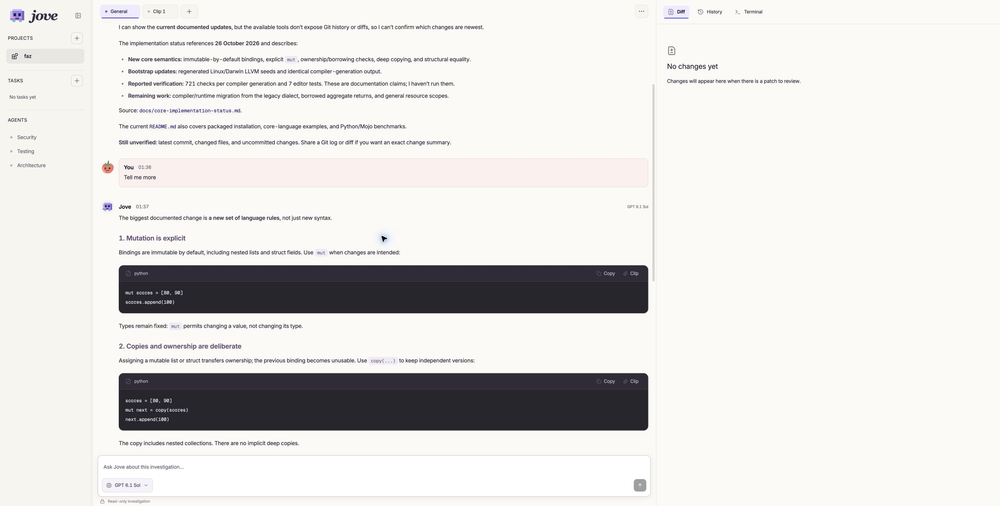
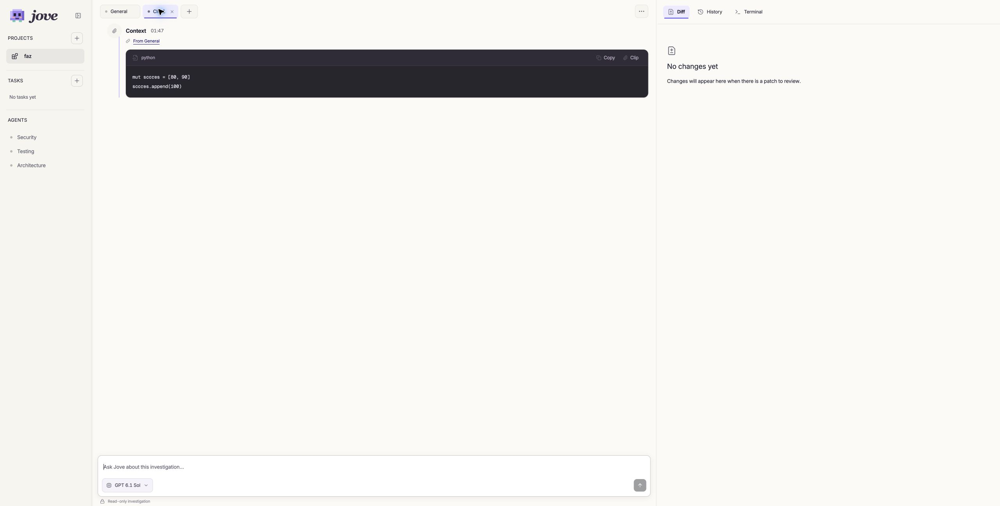

<p align="center">
  
</p>

<p align="center">
  <strong>Understand the code. Follow a tangent. Turn the answer into a task.</strong><br>
  Jove is a local development workspace for exploring your repository with AI,<br>
  carrying useful context into new conversations, and reviewing the changes you choose to make.
</p>

<p align="center">
  <a href="#get-started">Get started</a> ·
  <a href="#one-question-can-go-places">See the flow</a> ·
  <a href="#how-jove-works">How it works</a> ·
  <a href="#development">Development</a>
</p>

---

## Your code has a story. Follow it.

Start with “How does this work?” Keep asking until the next change is clear.

Jove gives each thread its own tab. When something deserves a closer look, **clip a sentence, a code block, or an entire message**. A new tab opens with exactly that context and a link back to its source. Your original conversation stays where you left it.

When you're ready to act, **add a task in one click**. Edit its objective inline, start it when you choose, and review the resulting changes in the same workspace.



_The current interface: your conversations in the center; Diff, History, and Terminal within reach._

## One question can go places

| You want to…                        | Jove gives you…                                                                                            |
| ----------------------------------- | ---------------------------------------------------------------------------------------------------------- |
| Understand an unfamiliar repository | Read-only investigation with streamed answers and inspectable source references.                           |
| Follow a promising tangent          | One-click clips that open a new conversation with selected context.                                        |
| Try another model                   | A model picker per tab. Ordinary new tabs inherit General's model; clips inherit their source tab's model. |
| Turn an answer into a change        | A task with the conversation's context and model, plus inline **Edit**, **Start**, and **Remove**.         |
| See what actually changed           | Recorded diffs, task details, verification results when available, and an inline terminal.                 |
| Pick up later                       | Conversations, context, and task state saved locally.                                                      |

### Clip → new tab → next question

1. **Select text** to reveal the small Clip/Copy toolbar, use **Clip** on a code block, or clip a whole user or assistant message.
2. Jove opens a new tab with the selection labeled **Context**. Code keeps its formatting and language.
3. The message box is focused. Ask your next question.

No destination form. No copied conversation history to sort through.



_Just the useful bit, with its origin attached._

### Queue it. Start when ready.

**Add to queue** creates a task immediately. It doesn't start writing code.

The task appears in the conversation and in the sidebar. Adjust its objective with **Edit**, choose **Start**, or **Remove** it before it runs. Each implementation attempt receives its own handoff and runs in a separate subagent process. Only one implementation can write to a worktree at a time.

Finished tasks return to the conversation with a **Review** action. Pause or interrupt active work; resume with the existing files preserved.

## Get started

You need **Node.js 22+**, **npm**, **Git**, and an installed, authenticated **Pi** for live AI conversations.

```sh
npm ci
npm run dev
```

Open **http://127.0.0.1:5173**.

1. Click **Import project** and choose a local Git repository.
2. Jove opens its primary workspace and **General** tab automatically.
3. Choose an available model below the message box and ask your first question.

Try:

> Trace how a request reaches the database. Show the files involved and where validation happens.

Jove prepares an isolated Git working copy from the repository's HEAD. Uncommitted changes in your original checkout stay there; they aren't copied into the new workspace.

<details>
<summary><strong>Run the built app or try the local demo</strong></summary>

```sh
npm run build
npm start
```

Open **http://127.0.0.1:4318**. This serves the built interface and API together.

To explore the bundled deterministic example without a live model:

```sh
JOVE_DEMO=1 npm run dev
```

The demo analyzes and edits a fixed example repository. It demonstrates the workflow; it doesn't answer arbitrary questions.

</details>

## Bring your model through Pi

Jove uses Pi's RPC interface and existing authentication. Configure and authenticate Pi first; Jove discovers its available models. There is no separate API-key form in Jove.

The current integration detects the installed <code>@router-for-me/pi-cliproxyapi-provider</code> extension, prefers CLIProxyAPI models, and excludes OpenRouter from the picker. Override the executable or extension path when needed:

```sh
export JOVE_PI_COMMAND='/absolute/path/to/pi'
export JOVE_PI_PROVIDER_EXTENSION='/path/to/pi-cliproxyapi-provider/extensions/index.ts'
npm run dev
```

If no model is available, check Pi's installation and authentication. The included demo remains available for trying the interface.

## How Jove works

**A local workspace, backed by Pi.** Jove owns the interface, durable conversations, context, task queue, and Git working copies. Pi runs the model/tool loop in fresh processes. Conversation requests include recent history and attributed context.

**Investigation before implementation.** Conversation tools can list, read, and search repository files. Implementation tasks additionally get scoped file-writing tools. Security, Testing, and Architecture specialists can be invoked for matching conversation requests.

**Everything close at hand.** The right pane holds Diff, History, and an interactive Terminal in the active workspace directory. The terminal stays inline and reconnects while you switch views.

**You keep the last word.** Jove doesn't automatically merge, push, or deploy your changes. A completed task's diff is a snapshot of cumulative worktree changes, so it can include earlier tasks.

<details>
<summary><strong>Local storage, recovery, and boundaries</strong></summary>

Data lives in <code>~/.jove</code> by default. Set <code>JOVE_DATA_DIR</code> to use another directory.

| Location     | What it contains                                               |
| ------------ | -------------------------------------------------------------- |
| state.json   | Persistent conversations, context, projects, and task records. |
| workspaces/  | Isolated Git working copies.                                   |
| checkpoints/ | Before-write recovery copies for live file overwrites.         |
| server.lock  | Ownership lock for the data directory.                         |

Closing tabs preserves their saved history. Removing a project preserves its files and saved work. Restarting during an implementation preserves the files and requires explicitly resuming that interrupted attempt.

Jove is a single-user local application. Its server binds to loopback; it isn't an authenticated hosted service.

**Local storage does not mean local inference.** Pi sends supplied context and requested source excerpts to your selected provider. Credentials stay with Pi. Common secret-file paths are excluded, but secrets embedded in ordinary source may still be included.

Git isolation and scoped tools are application-level protections, not an OS sandbox. The inline terminal runs with your local permissions.

Verification requires a configured command and explicit execution approval. The one-click queue does not grant that approval; don't treat an unrun test as a passing test. A verification command can be configured as JSON argv:

```sh
export JOVE_TEST_COMMAND='["npm","test"]'
```

Windows installation, large-repository performance, and every proxy model still need broader verification. See the [verification record](docs/VERIFICATION.md) for scope and limitations.

</details>

## Development

```sh
npm run format       # Apply Prettier
npm run check        # Check formatting and TypeScript
npm test             # Run the test suite
npm run build        # Build the app
```

The stack is **React · TypeScript · Vite · Tailwind CSS · Express · Pi RPC**. Tests exercise real temporary Git repositories, the local API, frontend workflows, and Pi protocol fixtures.

| Explore                          | Start here                                               |
| -------------------------------- | -------------------------------------------------------- |
| Interface and conversations      | [src/App.tsx](src/App.tsx)                               |
| Markdown and code blocks         | [src/MessageBody.tsx](src/MessageBody.tsx)               |
| Shared visual styles             | [src/design-system/paper.ts](src/design-system/paper.ts) |
| Local API and task orchestration | [server/app.ts](server/app.ts)                           |
| Pi integration                   | [server/pi.ts](server/pi.ts)                             |
| Product direction                | [Product requirements](docs/PRD.md)                      |
| Visual language                  | [Paper design system](docs/paper-design-system.md)       |

---

<p align="center">
  <br>
  <em>Stay curious. Bring the useful bits.</em><br>
  Built by <a href="https://x.com/thegrandimam">@thegrandimam</a>.
</p>
