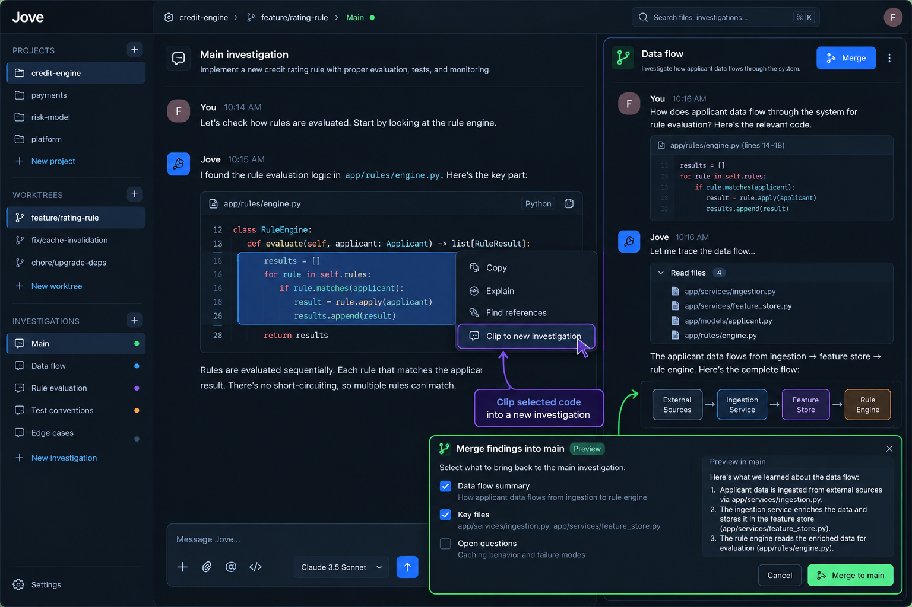
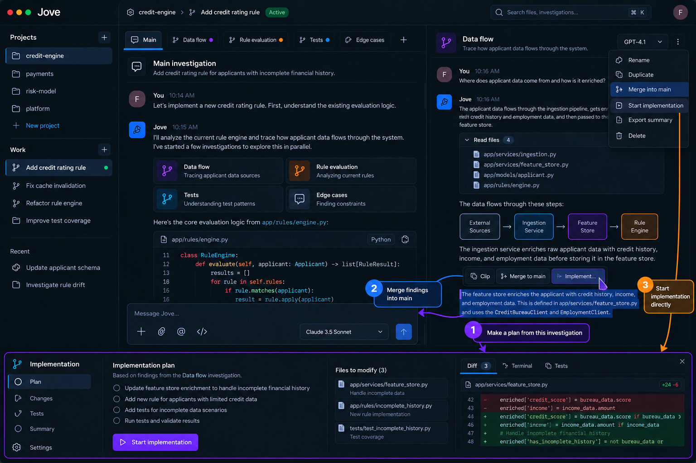

# Jove — Product Requirements Document

**Version:** 1.0 (V1)  
**Date:** October 28, 2026  
**Website concept:** jove.run  
**Status:** Product definition

## 1. Overview

Jove is an AI-assisted software development workspace for exploring unfamiliar codebases from multiple angles without losing the main implementation thread. Developers can **clip** context into a focused investigation, **merge** useful findings into another investigation, or **implement** directly from any investigation.

**Core promise:** *Investigate freely. Merge what matters. Implement when ready.*

Jove is not a general-purpose chat organizer or a Git worktree manager. Its primary abstraction is a piece of work and the investigations that contribute to it.

## 2. Problem

When developers work in unfamiliar repositories, a single AI conversation becomes overloaded with tangential questions about architecture, data flow, tests, and edge cases. Opening separate agent sessions helps, but creates new problems:

- Repeatedly explaining the same task and repository context.
- Manually copying conclusions between conversations.
- Losing the provenance of architectural discoveries.
- Polluting implementation context with long exploratory transcripts.
- Managing multiple terminals, branches, and worktrees explicitly.
- Having no clean way to convert one investigation into an implementation.

**Key insight:** The *work* is the unit of organization. Investigations are separate reasoning contexts within that work.

## 3. Goals and non-goals

### Goals

1. Create and resume project work with minimal setup.
2. Make focused investigations cheap to start from selected context.
3. Allow investigations to use different AI models.
4. Transfer selected findings between investigations without copying whole transcripts.
5. Start an implementation from the main investigation **or any child investigation**.
6. Keep Git worktree creation and lifecycle implicit while preserving safe isolation.
7. Show implementation progress, changed files, diffs, tests, and final outcome.

### Non-goals for V1

- Knowledge graphs and dependency-graph dashboards.
- Global, cross-project knowledge bases.
- Automatic agent swarms or autonomous investigation trees.
- Complex project planning or ticket management.
- Multiple concurrent code-writing agents against the same filesystem.
- Building a proprietary model or requiring one specific model provider.
- Full Git hosting/PR management as a prerequisite for use.

## 4. Information architecture

```text
Project
└── Work: Add credit rating rule
    ├── Main investigation
    ├── Investigation: Data flow
    ├── Investigation: Rule evaluation
    └── Investigation: Test conventions

Project
└── Work: Fix cache invalidation
    ├── Main investigation
    └── Investigation: Cache dependencies
```

### Project

A local repository opened in Jove. The project groups related work items. Users can open, switch, and create projects.

### Work

A user-visible unit of work such as “Add credit rating rule.” Each work item owns its main investigation, child investigations, implementation runs, and underlying isolated working directory. Users do **not** need to see or configure Git worktrees.

### Investigation

A persistent conversation with its own messages, model selection, and references. Every work item has one main investigation and zero or more child investigations. Child investigations can be created from a clip or directly.

### Implementation run

An execution context launched from any investigation. It receives a compact handoff artifact, modifies code in the associated work environment, runs verification, and reports results. The source investigation remains intact.

## 5. V1 interface

Three areas, with no dedicated graph or insights dashboard:

1. **Left navigation:** projects, work items, and investigations for the selected work.
2. **Primary pane:** main or selected investigation, with chat, tool output, code references, and message composer.
3. **Optional secondary pane:** another investigation side by side for clipping, comparing, and merging.

Implementation appears as a focused execution view showing activity, diff, terminal, tests, and summary. It should not permanently crowd the investigation UI.

### Reference A — Clip and merge



*Visual reference only. The final V1 should omit any explicit worktree-management navigation and use Project → Work → Investigations.*

### Reference B — Investigation to implementation



*Visual reference only. The implementation surface should open as a focused view, not a permanently visible dashboard.*

## 6. Core workflows and requirements

### 6.1 Create work (P0)

**User action:** Open a project, click **New work**, describe the objective.

**System behavior:**

- Create a work record and a main investigation.
- Prepare an isolated Git worktree and branch automatically, based on the selected repository/base revision.
- Associate agent sessions with the correct working directory.
- Open the main investigation when ready.
- Recover gracefully from worktree setup failures; do not silently overwrite existing directories or branches.

**Acceptance:** The user can create work without encountering the words *worktree*, *branch name*, or *directory path* in the normal flow.

### 6.2 Clip into investigation (P0)

**User action:** Select a message, code span, file reference, or agent output; choose **Clip → New investigation** or an existing investigation.

**System behavior:**

- Preserve the selected content and its source link/provenance.
- Include the current work objective and the minimum relevant context.
- Create an independent conversation history using the chosen model.
- Keep the clipped content visibly linked to its origin.

**Acceptance:** The child investigation can answer follow-up questions without requiring the developer to restate the main task.

### 6.3 Explore independently (P0)

- Investigations share the same underlying work filesystem and repository view.
- Each investigation has independent messages and context windows.
- Investigations can read code, search symbols, and use permitted terminal tools.
- Child investigations default to **read-only** codebase access in V1.
- Users can switch investigations or view two side by side.
- Model selection is per investigation and can differ from the main investigation.

### 6.4 Merge findings (P0)

**User action:** From any child investigation, select **Merge into Main**; optionally select individual findings or a target investigation.

**System behavior:**

- Generate a concise merge preview: conclusions, evidence, file references, decisions, open questions, and uncertainty.
- Let the user select what to include.
- Add an attributed context artifact to the target conversation; **do not concatenate entire chat histories**.
- Preserve the source investigation and a link back to the supporting messages.
- Avoid treating unverified claims as verified facts.

**Acceptance:** The target conversation can continue with the merged understanding, and the user can inspect where each claim originated.

**Important:** Context merge is **not** a Git merge and does not automatically apply file changes.

### 6.5 Implement from any investigation (P0)

**User action:** Choose **Implement** from the main or a child investigation.

**System behavior:**

1. Prepare a handoff brief containing objective, selected findings, relevant files, constraints, acceptance criteria, and unresolved assumptions.
2. Display a compact preview and allow the user to approve or edit it.
3. Start a **new implementation context** with a separately chosen model.
4. Preserve the original investigation and its conversation history.
5. Let the implementation agent edit files, run commands, and execute tests according to permissions.
6. Display live activity, changed files, diff, test results, and errors.
7. Allow interruption, follow-up instructions, and resumption.
8. Produce a completion summary including what changed, what was verified, and what remains unresolved.

**Acceptance:** A user can investigate a discovered issue in a child conversation and implement that issue directly without first merging it into Main.

### 6.6 Models per investigation and implementation (P0)

- Each investigation stores its selected provider/model.
- The implementation handoff independently selects a model.
- Model changes do not rewrite prior messages.
- Jove uses a provider-neutral message, tool, and artifact representation so context can cross model boundaries.
- Show the active model in the composer or investigation header, not in a separate management dashboard.
- Provider availability, credentials, and model-specific tool capabilities must be validated before starting a run.

**Example:** Main uses Claude; Data Flow uses GPT; Tests uses Gemini; implementation uses a different available model.

### 6.7 Safe execution and worktree isolation (P0)

- One work item maps to one Jove-managed Git worktree by default.
- Multiple investigations within that work share the worktree.
- Only **one active code-writing implementation** may operate on a work item at a time in V1.
- Other investigations may continue reading while implementation runs, but must be warned that files can change underneath them.
- Track the repository revision and file versions associated with findings and handoffs; flag potentially stale evidence after edits.
- Never discard uncommitted user changes automatically.
- Provide an advanced action to reveal the underlying branch/path and recover from Git conflicts.
- Archive work safely; cleanup of worktrees must require appropriate checks and user confirmation when changes would be lost.

## 7. Handoff artifact contract

An internal, model-neutral structured artifact should include:

```yaml
handoff:
  source_investigation_id: inv_data_flow
  work_id: work_rating_rule
  objective: Handle incomplete financial history in credit rules
  findings:
    - claim: Applicant data is enriched before rule evaluation
      evidence:
        - file: app/services/feature_store.py
          symbol: enrich_applicant
      confidence: verified_against_current_code
  constraints:
    - Preserve existing rule evaluation order
  acceptance_criteria:
    - Missing financial data is handled safely
    - Existing credit rule tests continue to pass
  open_questions:
    - Confirm desired fallback behavior for missing income
  repository_revision: <captured revision>
```

This is a **conceptual schema**, not a prescribed file format. The artifact must retain provenance and support explicit selection of what is transferred. If critical requirements are unresolved, the implementation agent should surface them rather than silently invent product decisions.

## 8. Primary UI actions

| Surface | Primary action | Secondary actions |
|---|---|---|
| Project | New work | Switch project |
| Work | Open main | Archive, reveal technical details |
| Investigation | Send message | Clip, switch model, rename |
| Selected content | Clip | Copy, inspect source |
| Child investigation | Merge into Main | Implement, merge elsewhere |
| Main investigation | Implement | Create child investigation |
| Handoff preview | Start implementation | Edit scope, choose model, cancel |
| Implementation | Review changes | Pause/interrupt, tests, terminal, resume |

## 9. UX principles

- **Work-first:** Developers should not manage Git infrastructure to perform ordinary tasks.
- **Cheap exploration:** Starting an investigation should feel like opening a new thought, not creating a new project.
- **Explicit knowledge transfer:** Merge useful conclusions, not transcript noise.
- **Flexible destination:** Any investigation may merge into another or hand off to implementation.
- **Focused surfaces:** Keep chat and code visible; show execution details only when needed.
- **Reversible actions:** Preserve investigation history and protect uncommitted changes.
- **Model choice without fragmentation:** Different models, one coherent work context.

## 10. Success metrics

**Activation:** User creates work, clips context into a child investigation, and either merges findings or starts implementation.

**Core workflow adoption:** Percentage of active work items with at least one child investigation; percentage of child investigations merged or implemented.

**Outcome quality:** Implementation completion rate; tests run and passing; frequency of manual context re-explanation; number of handoffs needing correction.

**Reliability:** Worktree setup failure rate; write-conflict incidents; lost-change incidents (target: zero); recovery success after interrupted runs.

**Retention:** Users returning to continue the same work item or start another within 7 and 30 days.

## 11. Delivery sequence

### Milestone 1 — Work and conversations

Projects, implicit worktree creation, work items, main investigation, child investigations, persistent sessions, model selection.

### Milestone 2 — Clip and merge

Context selection, provenance, child creation, merge preview, attributed findings transfer, side-by-side investigation UI.

### Milestone 3 — Implementation handoff

Implement from any investigation, structured handoff, model selection, execution context, diff/terminal/tests, interruption and completion summary.

### Milestone 4 — Hardening

Conflict prevention, stale-context warnings, interrupted-run recovery, work archival, reliable worktree cleanup, usability testing.

## 12. Open decisions

1. Whether merging to arbitrary investigations is V1 or whether **Merge into Main** is the initial default with general merging shortly afterward.
2. Whether implementation always requires explicit handoff approval or can be started immediately for low-risk tasks.
3. Which agent backends and model providers are supported at launch.
4. Whether a completed implementation automatically adds a concise result artifact to Main or asks the user first.
5. How to handle a child investigation that discovers a genuinely separate task: implement within current work or create new work automatically with user confirmation.

## 13. One-sentence positioning

**Jove lets you explore every angle of a codebase in separate AI investigations, merge what you've learned, and turn any investigation into working code—without losing your flow.**
