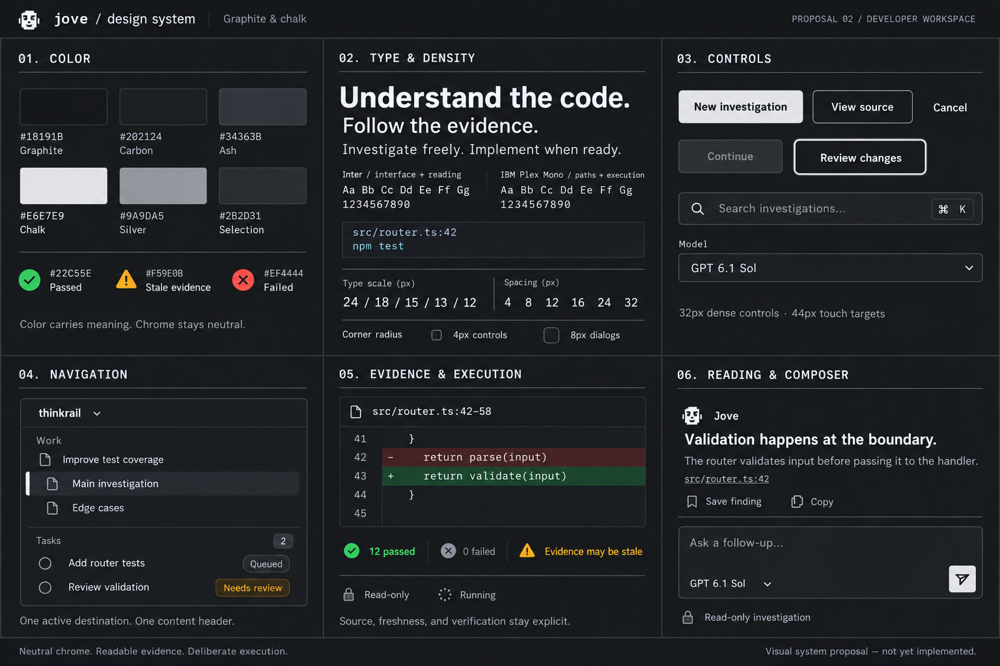

# Jove — Graphite & Chalk design system

Status: Historical proposal, superseded by the [Paper specification](../paper-design-system.md). The live implementation uses `src/design-system/paper.css` for tokens/base rules and `src/design-system/paper.ts` for Tailwind component recipes. References below to Graphite implementation files describe the former design, not current production imports. The specimen uses illustrative content.

## Direction

A neutral graphite workspace built for reading code investigations and making deliberate decisions. Use typography, alignment, and space to establish hierarchy. Reserve containers for interactive controls and bounded artifacts. Assistant responses remain ordinary document content.

## Tokens

| Role | Value | Usage |
| --- | --- | --- |
| Canvas | `#18191B` | Workspace background |
| Surface | `#202124` | Composer, menus, dialogs |
| Ink | `#E6E7E9` | Titles, body, primary action fill |
| Muted | `#9A9DA5` | Metadata and secondary labels |
| Border | `#34363B` | Decorative separators |
| Control border | `#777B84` | Essential control boundaries |
| Selection | `#2B2D31` | Selected navigation background |
| Selection edge / focus | `#E6E7E9` | Active edge and keyboard outline |
| Success | `#4ADE80` on `#163324` | Verified passing checks, additions |
| Attention | `#FBBF24` on `#352B17` | Stale evidence, attention required |
| Error | `#F87171` on `#381F23` | Failure, deletions |

Primary buttons use chalk fill and graphite text. Hover uses white; pressed uses `#CBCDD1`. Secondary buttons stay neutral. Links are underlined chalk; file references use monospace. There is no decorative brand accent. Do not use colored pills for ordinary navigation or model names.

Use the semantic text tokens above rather than sampling the generated image. Target 4.5:1 contrast for normal text and 3:1 for essential control boundaries and focus indicators. Status always includes a label and icon. Diff lines retain `+`/`−` markers and line numbers. Syntax colors must not be the only way to identify an error.

| Foundation | Specification |
| --- | --- |
| Interface font | Inter, with system sans-serif fallback |
| Code font | IBM Plex Mono, with system monospace fallback |
| Work title | 24px / 32px, weight 600 |
| Section heading | 18px / 26px, weight 600 |
| Reading text | 15px / 24px; compact UI text 13px / 20px |
| Metadata | 12px / 18px; never for primary content |
| Spacing | 4, 8, 12, 16, 24, 32, 48px |
| Radius | Inputs and buttons 4px; composer 6px; dialogs 8px |
| Icons | Existing Lucide icons, 16px, consistent stroke |
| Controls | 32px dense desktop; 36px primary controls; at least 44px touch targets |
| Reading width | 680–760px, flexible on narrow screens |
| Motion | 120–160ms for hover/focus; respect reduced motion |

## Component rules

- **Buttons:** primary chalk fill with graphite text, secondary neutral outline, quiet text. One dominant action per local task. Include hover, pressed, focus, disabled, and pending states. Pending actions retain their label and prevent duplicate submission.
- **Inputs:** persistent accessible labels, clear placeholder, inline validation. Use a 2px focus outline with 2px offset. Do not substitute placeholder text for a label.
- **Navigation:** project switcher and work list in the sidebar. Keep investigations in horizontal tabs. Each work row expands directly to its task executions, without an intermediate Tasks row. Work uses a briefcase icon; tasks use execution-state icons. Parent context stays visually quieter.
- **Status:** icon plus explicit label. Distinguish read-only, queued, running, paused, stopped, failed, and ready to review. A completed implementation does not imply tests passed.
- **Messages:** readable document typography, semantic lists, compact source references, visible Save finding action, secondary Copy action. Keep source attribution and stale-evidence warnings attached to the finding.
- **Composer:** modest bordered surface, auto-growing text area, subordinate model selector, explicit send/stop control. Enter sends; Shift+Enter inserts a line. Show read-only mode nearby.
- **Saved findings:** source-linked excerpts, not decorative summary cards. Saving opens the existing destination flow; selecting a finding returns to its source.
- **Implementation:** Prepare implementation opens the scope-review handoff. It never starts code changes directly. Preserve explicit approval and test-execution consent.
- **Dialogs:** named heading, focus trap, Escape to dismiss where safe, and focus returned to the initiating control. Destructive or irreversible behavior must never be hidden behind a generic primary label.

## Layout and responsive behavior

Use a 224px sidebar and a flexible reading area on desktop. Show work context only on request; it is not a permanent third column. At widths below 1100px, context becomes an overlay drawer. Below 768px, navigation becomes a drawer, the reading area takes full width, and controls retain text labels where space permits. Split investigations should become a single-pane switcher when two readable columns cannot fit.

## Implementation

The app uses Tailwind CSS through `@tailwindcss/vite`. `src/design-system/graphite.css` contains only the Tailwind import and semantic theme tokens. Shared component recipes live in `src/design-system/graphite.ts`; state and responsive variants use Tailwind utilities. The old `src/styles.css` and `src/polish.css` have been removed.

Inter and IBM Plex Mono are bundled locally through Fontsource. Investigations use horizontal tabs above the workspace. Each work expands directly to its task executions, with execution-state icons and explicit start, pause, resume, and review controls. Narrow screens use a navigation drawer. Dialogs trap keyboard focus and restore it on dismissal. The existing investigation, clip, merge, task approval, and execution flows remain in place.

To change the visual system, update the theme tokens or shared utility recipes. Do not add another override stylesheet. The portable `tokens-graphite.css` remains a design reference, not a production import.

## Review scope

The running application's investigation view was inspected with computer use. This image is a generated visual specimen, not a browser-rendered implementation or a verified interactive prototype. Exact tokens and behavior in this document take precedence over approximations in the image. The original image remains a design reference; the production interface is implemented separately with Tailwind.

Image generation: built-in imagegen tool. Prompt saved alongside this file as `design-system-graphite-prompt.txt`. The generated image is a style specimen; subtle rendering variation is not a requirement to introduce gradients, glows, or shadows.

## Developer-specific state contracts

| State | Treatment | Required behavior |
| --- | --- | --- |
| Read-only | Lock + neutral label | Clearly distinguish investigation from writing |
| Queued | Neutral clock + label | Start only under existing queue approval behavior |
| Running | Neutral spinner + label | Expose stop/pause and current activity; reduced-motion fallback |
| Paused / stopped | Neutral pause/stop icon + label | State that existing changes are retained; offer deliberate resume |
| Failed | Red error icon + label | Show actionable failure detail and preserve output |
| Ready to review | Amber review icon + label | Open changes; never imply verification passed |
| Tests not run | Neutral explicit label | Never render a green check |
| Tests passed | Green check + actual count | Show only from recorded execution results |
| Stale evidence | Amber triangle + label | Retain original attribution and offer rechecking |

Empty screens offer one useful next action. Loading preserves shell geometry. Long paths truncate in navigation but remain fully accessible in details. Long code lines scroll within their code block, not the whole workspace. Keyboard focus and source selection must survive streaming updates.

## Delivered artifacts

- `design-system-graphite.png`: generated visual specimen.
- `tokens-graphite.css`: portable implementation tokens, not imported by the application.
- `design-system.md`: canonical component and interaction specification.
- `design-system-graphite-prompt.txt`: generation prompt.
